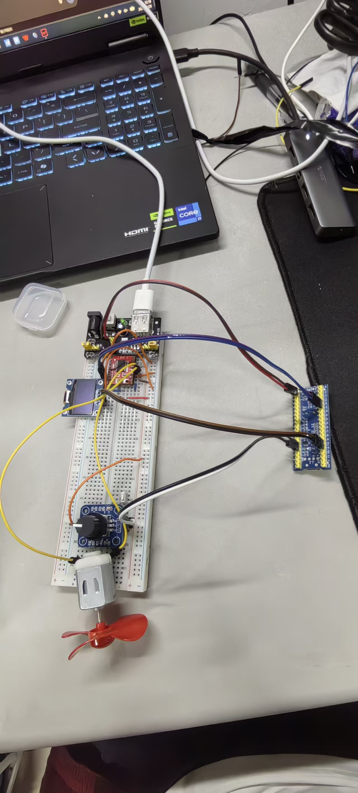

\# 作品名称
可调节转速风扇

\## 1. 功能概述

可调节转速风扇，电机驱动叶片，旋钮控制转速，OLED显示转速挡位

\## 2. 硬件清单

| 名称 | 型号 | 数量 | 用途 |

|------|------|------|------|

| STM32 开发板 | STM32F103C8T6 | 1 | 主控 |

|电机驱动模块 |TB6612  | 1 |控制电机正反转与调速 |

|普通电机|通用型| 1 | 风扇 |

|旋转编码器模块|EC11| 1 |旋转调节参数|

|OLED显示屏模块|0.96寸 128\*64（IIC/SPI接口）| 1 |显示转速|

|面包板电源模块|HW-131| 1 |为面包板及电路提供 3.3V/5V 稳定供电|

\## 3. 接线表

| 信号 | STM32 引脚 | 外设引脚 | 备注 |

|OLED\_SCL|PB10|OLED\_SCL|无|

|OLED\_SDA|PB11|OLED\_SDA|无|

|TIM1\_CH1 | PA8 | 旋转编码器模块A口 | 无 |

|TIM1\_CH2 | PA9 | 旋转编码器模块B口 | 无 |

|TIM2\_CH1 | PA0 | 电机驱动模块AO1 | 无 |

|TIM2\_CH2 | PA1 | 电机驱动模块AO2 | 无 |

|GND | GND | 所以外设GND | 无 |

|VCC | 3.3 | 电源模块3.3V/电机驱动模块PWMA/电机驱动模块STBY/其他所有3.3V接口 | 电机驱动模块VM接电源模块5V |

（再附一张接线图 / 面包板照片）

> 📌 最终考核主控固定为 \*\*STM32F103C8T6\*\*；其余模块自行购买，团队不提供借用。

\## 4. 实现思路

\- 系统框图（文字或图片）
1. **输入层**：TIM1 定时器配置为编码器模式，读取电机转速脉冲；I2C2 连接 OLED 屏幕。
2. **控制层**：STM32 主控芯片（通过 HAL 库运行），读取编码器计数值，将其映射为 0~100 的 PWM 占空比。
3. **输出层**：TIM4 输出 PWM 波控制 DRV8833 电机驱动模块，进而控制直流电机转速；OLED 屏幕实时刷新显示计数值与进度条。

\- 主循环 / 状态机怎么组织
系统初始化完毕后，进入 `while(1)` 无限循环，执行周期如下：
1. **数据采集**：读取 TIM1 编码器计数器的值 `count`。
2. **边界保护**：判断 `count` 是否溢出（>60000）或超限（>MAX）。若超限则进行清零或钳位（防止数值溢出导致电机异常）。
3. **数据转换**：将 `count` 线性映射到 `0~100` 的速度值 `speed` (`speed = count * 100 / MAX`)。
4. **执行控制**：调用 `DRV8833_Forward(speed)` 更新 TIM4 的 PWM 占空比，驱动电机。
5. **UI 刷新**：清空 OLED 帧缓冲，格式化字符串显示 `count/2` 数值，绘制矩形框和动态填充的进度条，最后调用 `OLED_ShowFrame()` 推送到屏幕。

\## 5. 参考来源

| 参考方案 / 教程 | 链接 | 参考了什么 | 我做了哪些改动 |
| **1. 【STM32入门教程】电机&驱动 ，超清晰动画讲解** https://www.bilibili.com/video/BV1jBxkeMEWU | 参考了电机原理、DRV8833 驱动模块的硬件接线思路、PWM 调速逻辑以及定时器编码器模式的配置方法。 | 根据实际硬件重写了引脚配置（TIM4_CH4 输出 PWM，TIM1 读取编码器）；重写了电机控制驱动函数 `DRV8833_Forward()`。 |
| **2. 【STM32入门教程-2025】第14集 如何在OLED屏幕上挥毫** https://www.bilibili.com/video/BV19u4y197df | 参考了 I2C OLED 屏幕的驱动移植（`OLED_Init`）、帧缓冲刷新机制、中英文字符串打印（`OLED_PrintString`）以及基础图形的绘制方法（矩形框与填充矩形）。 | 将屏幕显示与电机数据结合，用OLED显示电机相对速度 |

*(说明：项目中的代码编写、硬件连线、逻辑整合与整机调试均由本人独立完成。)*
| 例：XX 开源项目 | https://... | 硬件接线思路 | 重写主逻辑、改引脚 |

（参考/复刻允许，但代码、接线、调试必须自己完成；没有参考就写「原创」）

\## 6. 遇到的问题与解决

| 问题 | 现象 | 原因 | 解决 |
|上电后电机无响应|电机驱动模块只接了VCC\GND\输出输入口|PWMA与STBY接口未接3.3V|接上PWMA与STBY|
| 面包板插上STM32板后所有外置硬件无响应 | OLED与电机无响应 | 面包板接口与STM32引脚接触不良 | 用杜邦线把STM32对应引脚连接到面包板上 |
| 想加入舵机实现风扇摆头效果 | 舵机响应慢且卡顿 | 可能是舵机内部齿轮卡顿 | 未解决，放弃舵机摆头部分 |

\## 7. 测试结果

\- 测试旋钮旋转后，电机转速正常改变，OLED上数字与进度条正常改变。问题：当电机转速过快时，有小概率触发转速锁死，旋钮无法改变转速与OLED显示转速，猜测为电机引发震动使线路接触不良。重启电源可重新正常工作。

\## 8. 演示说明

\- 初始电机转速为0，转动旋钮可改变转速（共10档，除去0档），可在OLED上显示挡位，且有挡位显示进度条。
\- 演示视频链接（见下一节）
## 演示说明

[点击观看/下载最终考核作品演示视频](https://github.com/jianghe-x2026/LightChaser-Training-72/releases/download/v1.0-final/default.mp4)
